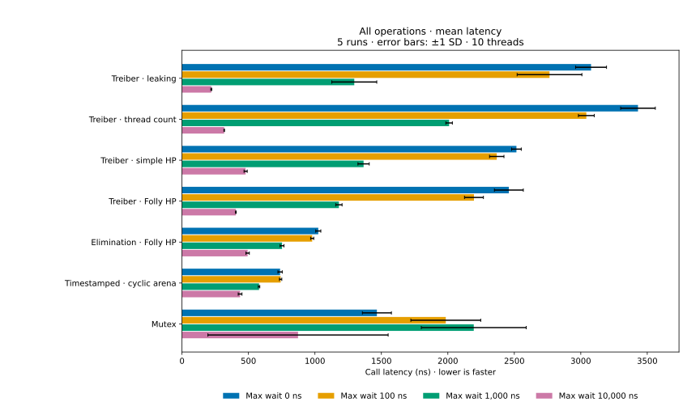
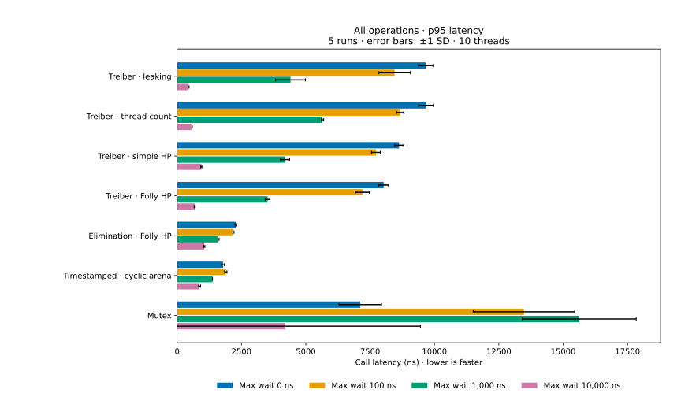
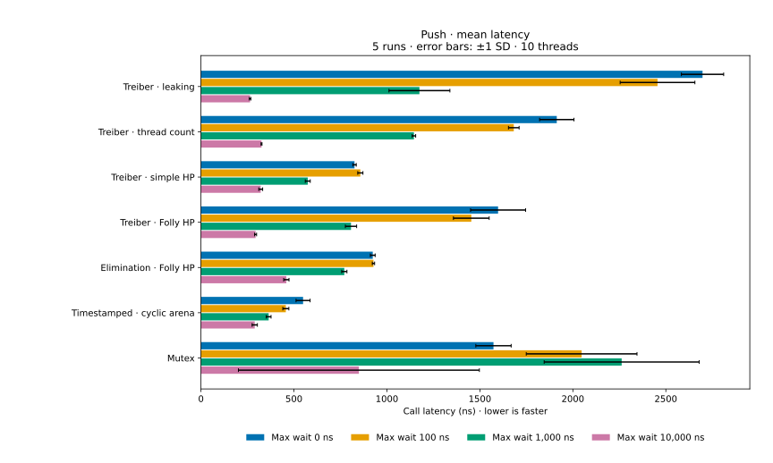
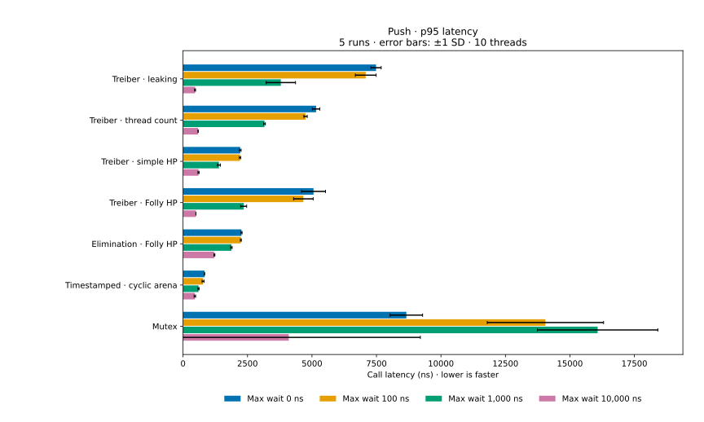
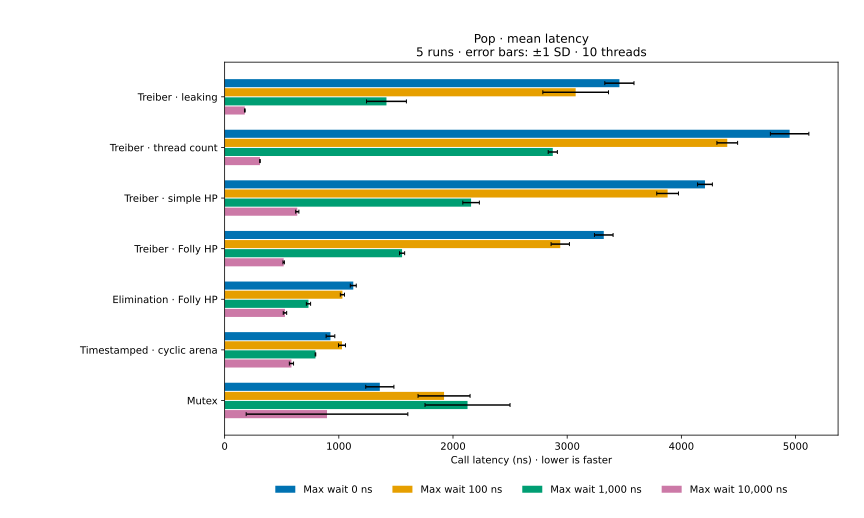
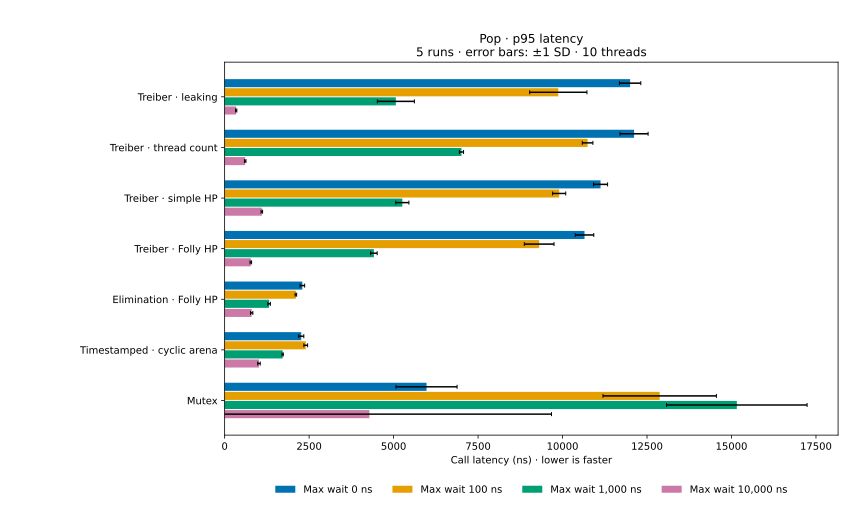

# C++ concurrency library

A repository comparing concurrent data structures and memory reclamation
strategies. It includes written [implementation notes](stack/notes.md).

## Implementations

| Benchmark type | Algorithm and memory management | Source |
| --- | --- | --- |
| `lock_free_stack_leaking` | Treiber stack; popped nodes deliberately leak | [treiber.cpp](stack/treiber.cpp) |
| `lock_free_stack_keep_thread_count` | Treiber stack; reclamation when the number of active pops hits 0 | [treiber.cpp](stack/treiber.cpp) |
| `lock_free_stack_hazard_pointer_simple` | Treiber stack; reclamation with our simple hazard pointer implementation | [treiber.cpp](stack/treiber.cpp), [hazard_pointers/](hazard_pointers/) |
| `lock_free_stack_folly` | Treiber stack; reclamation with Folly's hazard pointer implementatoin | [treiber.cpp](stack/treiber.cpp) |
| `ebs_stack_folly` | [Elimination backoff stack](https://people.csail.mit.edu/shanir/publications/Lock_Free.pdf); lock-free stack with an elimination array and exponential waiting-window backoff | [elimination_backoff.cpp](stack/elimination_backoff.cpp) |
| `timestamped_stack` | [Timestamped stack](https://dl.acm.org/doi/10.1145/2775051.2676963); cyclic pools for allocation; Sequential consistency relaxed | [timestamped.cpp](stack/timestamped.cpp) |
| `mutex_stack` | Linked stack protected by `std::mutex` | [mutex_stack.cpp](stack/mutex_stack.cpp) |


## Build

```sh
cmake -S . -B build-vcpkg -DCMAKE_BUILD_TYPE=Release \
  -DCMAKE_TOOLCHAIN_FILE="$VCPKG_ROOT/scripts/buildsystems/vcpkg.cmake"
cmake --build build-vcpkg -j 4
```

## Benchmark properties

Benchmark was run on a MacBook Pro M3 with 18GB of RAM and 11 cores.

`BM_RandomPushPopRandomWait` uses **10 threads**, each making **1,000,000 calls**
with a 50/50 push/pop probability. The stack starts with 10,000 values. After each call,
the thread spins for a uniformly random duration between 0 and the configured bound (0, 100, 1,000, or 10,000 ns) as a way to vary contention. The time it takes for each operation to return is measured. 

Workloads match across stacks within each
run by using the same seed, with a new seed for the next run. Workers are not pinned to cores.

## Benchmark results

<!-- BENCHMARK_RESULTS_START -->

Mean latency and p95 averaged across **5 sequential runs**, with ten workers.
Error bars show ±1 sample standard deviation across runs.














## Reproduce the results

Requires Matplotlib and NumPy. Build the executable, then run:

```sh
python3 benchmark/run.py
```
